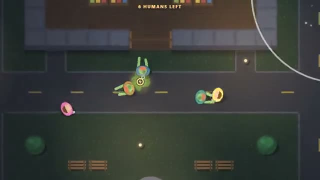

# Outbreak IO

One bite and you're one of them. A multiplayer starter game from [Multiplayer Agent](https://multiplayeragent.com): 2D, drop-in, 2–20 players, with bots that fill both sides.

## How it plays

A zombie or two rise from the graveyard and every survivor they touch turns too. Survivors win if anyone is still human when the timer runs out; grab speed shoes, decoys, flashbangs and boards around town, and shove zombies back when they get close.

**Controls:** WASD or hold the mouse to run, Space to shove, E to use your item; on touch, drag to run and tap SHOVE or the item button.

## Make it yours in the Game Builder

Open the [Game Builder](https://multiplayeragent.com), choose **Start from a starter game** and pick Outbreak IO. It opens as version 1 in your studio, ready to play and publish. Then ask for changes, for example:

- Add a safe house that opens for the last 20 seconds
- Give zombies a sprint they can use every 10 seconds
- Make it a snowy ski resort with yetis instead of zombies

## Run it yourself

1. Get a free publishable key (`pk_…`) at [multiplayeragent.com](https://multiplayeragent.com).
2. In `index.html`, put it in place of `pk_REPLACE_ME` in the `MP_CONNECT` block.
3. Open `index.html` in a browser. No build step and no server needed.

Without a key it still runs, offline against bots.

## How it is built

- One `index.html`. The comment at the top of the script maps the code and explains the multiplayer.
- The town is `CONFIG.map`: one string per row, one letter per square (walls, doorways, streets, graves, item spots). Edit it to make a new map.
- **Leaderboard:** Each player's best round: seconds survived, bites and a bonus for lasting to the end.
- **Host-run rules:** The host's browser decides every bite, pickup, stun and barricade; if it leaves, the next player takes over.
- **Bots:** Bots fill both sides: survivors run and use items, zombies hunt the nearest human.
- **Live sync:** Every player, zombie, item and boarded-up door is the same for everyone.
- Players who join mid-round rise as zombies in the graveyard.
- `?attract` runs it offline with bots only. The preview video is recorded from it.

## License

MIT.
